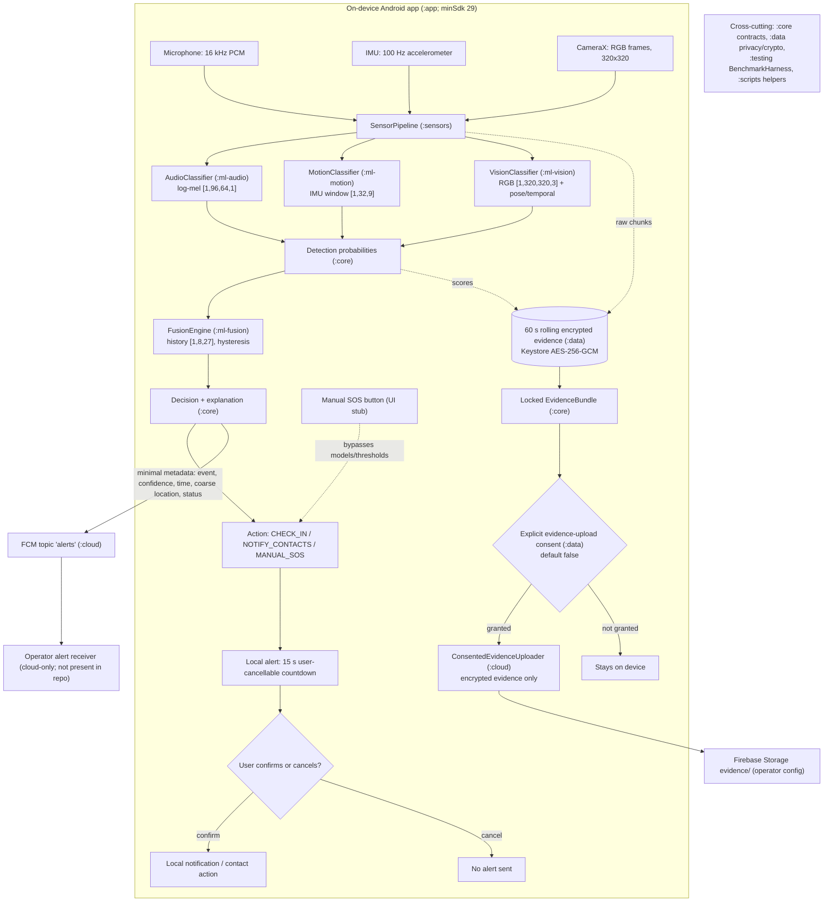

# Architecture — Human BlackBox Emergency Pipeline

## Overview

Human BlackBox is an on-device emergency detection system. Sensor data from
the microphone, IMU and camera is scored independently by one detector per
modality, the scores are combined by a fusion strategy, and the rolling
evidence buffer keeps the last 60 seconds of context. When fusion decides
`EMERGENCY`, the alert sender runs a user-cancellable 15-second countdown
before any alert leaves the device. Raw media never leaves the device unless
the user explicitly opts in.

`modules/pipeline.py` is the integration seam: it owns no models or sensor
drivers, and receives every collaborator through its constructor so it can be
tested deterministically with stubs.

## v2 module and deployment view (skeleton, unbuilt)

The 11-module Gradle project (`settings.gradle.kts`) is present with build files
and source skeletons. The diagram below is the intended v2 wiring; it is **not a
record of a running build**. Kotlin modules have not been compiled, models are
absent, and the app screen is a stub. The Python pipeline described later in
this document is the only runnable implementation today.



Key boundaries:
- `:core` owns shared contracts (`Detection`, `Decision`, `EvidenceBundle`);
  `:sensors` owns capture Flows; each `:ml-*` module owns one inference head;
  `:ml-fusion` owns temporal fusion; `:data` owns preferences and encrypted
  evidence; `:cloud` owns FCM/Firestore/Storage gateways; `:app` wires them.
- Inference and the 60 s evidence buffer are local. Default alert payload is
  metadata only. Evidence upload is a separate, consent-gated capability.
- **No automatic emergency call exists.** Any such integration needs explicit
  configuration, user confirmation and legal review.
- Known gaps blocking this wiring: fusion declares `[1,8,27]` but writes 33
  values per tick in `FusionEngine.decide`; capture currently supplies no gyro
  (motion input needs nine features); `:cloud` has no Firebase Auth dependency;
  the SOS button callback is unimplemented. See
  [`MODEL_CARDS.md`](./MODEL_CARDS.md) and
  [`PHASED_PLAN.md`](./PHASED_PLAN.md).

## Flow (runnable Python baseline)

```text
 microphone ──> AudioDetector ──┐
 IMU        ──> MotionDetector ─┼──> FusionStrategy ──> ModalityScore
 camera     ──> VisionDetector ─┘          │
                                           │ EMERGENCY
                                           v
                                   AlertSender.send()
                                           │
                             15 s user-cancellable countdown
                                           │
                                           v
                                   alert transmitted
        ┌──────────────────────────────────────────────┐
        │ RollingBuffer: last 60 s of chunks + scores  │
        │ (encrypted, on-device evidence)              │
        └──────────────────────────────────────────────┘
```

Every chunk/score pair is appended to the rolling buffer before fusion, so
the evidence window always includes the samples that triggered a decision.
The buffer is passed to `AlertSender.send()` as evidence and is not uploaded
by default.

## Safety gates (non-negotiable)

1. **Visible recording indicator whenever recording.**
   `UserConsentManager.start_recording()` turns it on;
   `EmergencyPipeline.safety_audit()` reports it.
   Config: `safety.recording_indicator`.
2. **Explicit, revocable mic/camera consent before recording.**
   `start_capture()` delegates to `start_recording()`, which refuses without
   consent. Config: `safety.require_mic_consent`,
   `safety.require_camera_consent`.
3. **User-cancellable 15 s countdown before any alert.**
   `AlertSender.send()` runs the countdown; `cancel_user_countdown()` aborts
   it. Config: `alert.countdown_sec`.
4. **Raw media stays on-device unless explicit opt-in.**
   Alert payload carries hashes/metadata only; sharing is opt-in.
   Config: `safety.raw_media_on_device`, `safety.share_evidence_default`.

`safety_audit()` returns a boolean per gate (`recording_indicator`,
`mic_consent`, `camera_consent`, `countdown_cancellable`,
`raw_media_on_device`) so the UI or a supervisor can verify the guarantees at
runtime.

## Data flow

1. A sensor chunk (`AudioChunk`, `ImuSample`, `Frame`) arrives from capture.
2. `EmergencyPipeline.process()` runs only the detectors whose chunk is not
   `None`; each returns a `ModalityScore`.
3. Each `(chunk, score)` pair is appended to the `RollingBuffer`.
4. `FusionStrategy.decide()` combines all scores from this round using the
   configured weights (AUDIO 0.40, MOTION 0.35, VISION 0.25), the fusion
   threshold (0.55), the confidence gate (`min_confidence` 0.30) and the
   two-modality requirement.
   It also computes temporal coherence and event start/end spans. When runtime
   `ambient_mean`/`ambient_std` statistics are supplied with
   `ambient_baselines.per_modality` features, an ambient Z-score boost raises
   scores that deviate from the rolling baseline and records the factors in
   `raw_features["ambient_boosts"]`.
5. The fused `ModalityScore` is stored in `last_decision` and returned.
6. If the decision is `EMERGENCY`, `AlertSender.send()` is called exactly once
   for that round. A cancelled or failed send returns `False` but does not
   alter the decision returned to the caller.

## Timing

- **Evidence buffer:** 60 s (`buffer.size_sec`), encrypted at rest, written on
  every processed chunk and loaded back on startup.
- **Countdown:** 15 s (`alert.countdown_sec`) between the emergency decision
  and transmission, cancellable at any point.
- **Inference budget:** 100 ms per round (`inference_timeout_ms`), 16-item
  batches (`batch_size`).

## Failure modes

- **Detector raises or model missing.** The exception propagates; the round
  produces no decision. Detection must be fixed rather than silently degraded.
- **Detector unavailable for a round.** Its chunk is `None`, so it is skipped;
  fusion uses the remaining modalities. With fewer than two modalities,
  fusion returns `NORMAL`/`INDETERMINATE` per its contract.
- **No sensor input at all.** Pipeline returns `INDETERMINATE` without calling
  fusion or the alert sender.
- **Fusion unavailable.** Exception propagates; no alert is sent, because no
  decision was made.
- **Alert send returns `False`.** Treated as user cancellation: no retry
  storm, decision is still returned and logged.
- **Consent missing.** `start_capture()` returns `False` and the indicator
  stays off; `safety_audit()` reports the failing gate.
- **Countdown cancelled.** `AlertSender.send()` returns `False`; no payload
  leaves the device.
- **Buffer write failure.** `process()` surfaces the error; evidence integrity
  is not silently ignored.
- **Device offline.** Detection, buffering and countdown are fully local; only
  transmission is deferred/retried per `alert.max_retries`.

## Module boundaries

- `modules/modality_types.py` — canonical shared types and constants
  (coordinator-owned, read-only).
- `modules/types.py` — backwards-compatible re-export shim for
  `modules.modality_types`; kept so older imports keep working.
- `modules/pipeline.py` — this integration layer (owned by integration-safety).
- Detectors, fusion, buffer, alerting and consent live in their own modules and
  are injected; the pipeline imports only the `modules.types` shim at module
  level.

## Future work

This document describes the shipped architecture (159 tests green). The planned
enhancements are specified separately, are **not implemented**, and are future
post-thesis work:

- `ROADMAP.md` — index, dependency graph, sequencing and evaluation protocol.
- `TIER1-CONFORMAL-FUSION.md` — conformal-calibrated, cost-sensitive fusion
  (replaces the fixed `0.65` threshold when enabled).
- `TIER2-TEMPORAL-EVENT-FUSION.md` — gated-CNN temporal models and event-level
  fusion (replaces per-instant scoring).
- `TIER3-PERSONALIZATION.md` — on-device adaptive head, prototype replay and
  opt-in federated learning.
- `TIER4-DEPLOYMENT-PRIVACY.md` — real AES-256-GCM provider, key store,
  thermal/mmWave alternatives to RGB, and resource budgets.

Every item is designed to ship behind an `enabled: false` flag so the current
behaviour in this document remains byte-identical.

## v2 documentation index

- [`MODEL_CARDS.md`](./MODEL_CARDS.md) — audio, motion, vision, fusion and
  personalization contracts; all metrics TBD/unmeasured.
- [`DEPLOYMENT_GUIDE.md`](./DEPLOYMENT_GUIDE.md) — configuration placeholders,
  privacy defaults and required operator inputs.
- [`PHASED_PLAN.md`](./PHASED_PLAN.md) — seven phases with gates and blockers.
- [`EVALUATION_PLAN.md`](./EVALUATION_PLAN.md) — metrics, splits and conditions;
  no results claimed.
